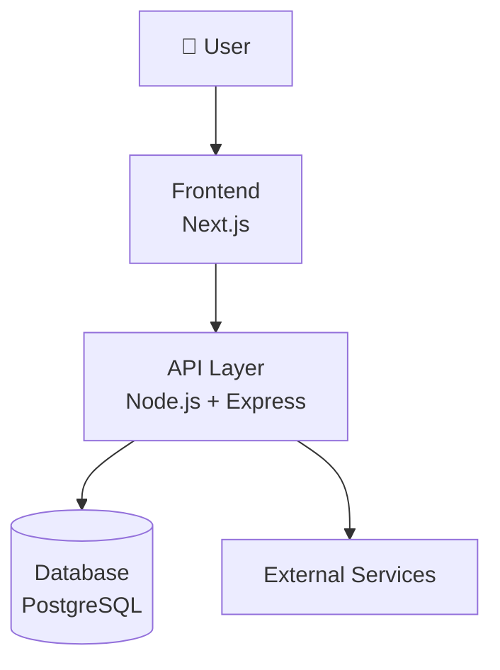
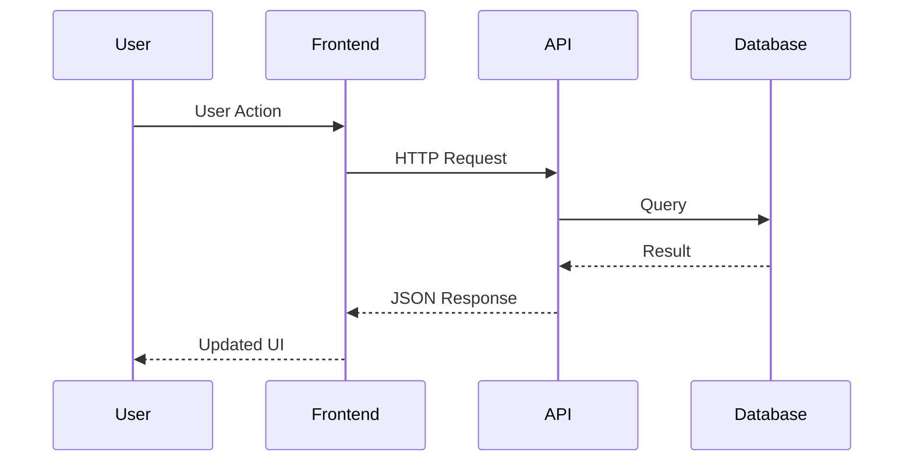

# Senior Project — Senior Project Specification

> **สำหรับโปรเจกต์จบการศึกษา / วิจัยระดับปริญญาตรี**
> สร้างโดย AppForge | ปีการศึกษา 2026

---

## 📋 PROJECT OVERVIEW

**ชื่อโปรเจกต์:** Senior Project
**ประเภท:** Senior Project / งานวิจัย
**คำอธิบาย:** ระบบ web application สำหรับโปรเจกต์จบการศึกษา พร้อม spec และ documentation ส่งอาจารย์
**กลุ่มเป้าหมาย:** นักเรียน / นักศึกษา
**แพลตฟอร์ม:** Desktop App
**Stack:** Next.js + Node.js + Express + PostgreSQL

---

## 🎯 บทนำ (Introduction)

### ปัญหาและที่มา (Problem Statement)
นักศึกษาต้องส่ง senior project แต่ไม่รู้จะเขียน spec architecture และ documentation ในรูปแบบที่อาจารย์ต้องการ

### วัตถุประสงค์ (Objectives)
ได้ app ที่ใช้งานได้จริง พร้อม README architecture diagram presentation slides outline และ project spec ครบสำหรับการส่งงาน

### ขอบเขตของโปรเจกต์ (Scope)
- **ขอบเขตที่ครอบคลุม:** ระบบ Senior Project บน Desktop App
- **กลุ่มผู้ใช้:** นักเรียน / นักศึกษา
- **ฟีเจอร์หลัก:** Authentication & User Accounts, Responsive UI (mobile-first), Real-time updates (WebSocket)
- **นอกขอบเขต:** Mobile native app, third-party integrations นอกเหนือจากที่ระบุ

---

## 🏗️ สถาปัตยกรรมระบบ (System Architecture)

### Tech Stack
| Layer | Technology | เหตุผลที่เลือก |
|-------|-----------|--------------|
| Frontend | Next.js | Component-based, TypeScript support, ecosystem ครบ |
| Backend | Node.js + Express | Built-in API routes |
| Database | PostgreSQL | Relational, ACID compliant |
| Deploy | Vercel + Supabase | CI/CD, preview deployments |


### Architecture Diagram


### Data Flow Diagram


---

## ✨ Features Required
- [ ] **Authentication & User Accounts**
- [ ] **Responsive UI (mobile-first)**
- [ ] **Real-time updates (WebSocket)**
- [ ] **Push Notifications**
- [ ] **LINE Notification**
- [ ] **File Upload & Storage**
- [ ] **Search & Filters**
- [ ] **Payment Integration (Stripe/Omise)**
- [ ] **Admin Dashboard**
- [ ] **Dark mode / Theme switching**
- [ ] **Offline support (PWA)**
- [ ] **Internationalization (i18n)**
- [ ] **Analytics & Reporting**
- [ ] **SEO & Meta Tags**
- [ ] **AI / ML Integration**
- [ ] **Quiz Engine & Scoring**
- [ ] **Gamification & Badges**
- [ ] **CLAUDE.md + AI Workflow**

---

## 📐 Database Schema

### Core Entities
> ออกแบบ entity ตามฟีเจอร์ที่เลือก — ตัวอย่างด้านล่าง

```
User {
  id (PK), email, passwordHash,
  displayName, role (admin|user),
  createdAt, updatedAt
}

[Main Entity] {
  id (PK), title, description,
  status, createdBy (FK → User),
  createdAt, updatedAt
}
```

---

## 🧪 แผนการทดสอบ (Test Plan)

| ประเภทการทดสอบ | เครื่องมือ | เกณฑ์ผ่าน |
|--------------|---------|---------|
| Unit Test | Jest / Vitest | Coverage ≥ 70% |
| Integration Test | Supertest | API endpoints ทั้งหมด pass |
| E2E Test | Playwright | Happy path scenarios pass |
| Performance | Lighthouse | Score ≥ 80 ทุก category |
| Accessibility | axe-core | Zero critical violations |

---

## 📊 Presentation Slides Outline (8–10 slides)

> สร้าง slides ใน Google Slides / PowerPoint ตามโครงสร้างด้านล่าง

**Slide 1 — ปกโปรเจกต์**
- ชื่อโปรเจกต์: Senior Project
- ชื่อผู้จัดทำ, รหัสนักศึกษา
- อาจารย์ที่ปรึกษา
- ปีการศึกษา 2026

**Slide 2 — ปัญหาและที่มา**
- ปัญหาที่พบในปัจจุบัน
- ผลกระทบต่อกลุ่มเป้าหมาย
- Infographic หรือสถิติสนับสนุน

**Slide 3 — วัตถุประสงค์และขอบเขต**
- Objective 3–5 ข้อ (SMART goals)
- ขอบเขตที่ครอบคลุม / ไม่ครอบคลุม

**Slide 4 — ระบบที่พัฒนา (Demo)**
- Screenshots หน้าจอหลัก
- User flow สั้นๆ 3–5 ขั้นตอน
- Live demo link (ถ้ามี)

**Slide 5 — สถาปัตยกรรมระบบ**
- Architecture diagram (ใช้ Mermaid หรือ draw.io)
- Tech stack table
- เหตุผลที่เลือก stack นี้

**Slide 6 — ผลการทดสอบ**
- Test coverage report
- Performance metrics (Lighthouse score)
- Bug count / severity ที่แก้ได้

**Slide 7 — ปัญหาที่พบและวิธีแก้**
- 3 ปัญหาหลักที่เจอระหว่างพัฒนา
- แนวทางที่ลอง / วิธีที่เลือก / เหตุผล

**Slide 8 — สรุปและงานต่อไป (Future Work)**
- สรุปสิ่งที่ทำสำเร็จ vs. วัตถุประสงค์
- ข้อจำกัดของระบบ
- Feature ที่ต้องพัฒนาต่อ

**Slide 9 — เอกสารอ้างอิง**
- Bibliography (APA format)
- Library / framework ที่ใช้ + version

**Slide 10 — Q&A**
- คำถามที่คาดว่าจะถามและคำตอบสั้นๆ

---

## 📋 Project Tasks (Academic Milestones)

### Sprint 1 — Proposal & Design (สัปดาห์ 1–2)
- [ ] เขียน project proposal และส่งอาจารย์
- [ ] ออกแบบ database schema
- [ ] สร้าง wireframe หน้าจอหลัก
- [ ] ตั้งค่า development environment

### Sprint 2 — Core Implementation (สัปดาห์ 3–6)
- [ ] Setup project structure + CI/CD
- [ ] สร้าง database + migration
- [ ] พัฒนา Authentication
- [ ] พัฒนา core features ตามวัตถุประสงค์

### Sprint 3 — Feature Complete (สัปดาห์ 7–9)
- [ ] พัฒนา features ทั้งหมดให้ครบ
- [ ] Integration testing
- [ ] ทำ UI polish และ responsive
- [ ] User acceptance testing กับกลุ่มตัวอย่าง

### Sprint 4 — Defense Preparation (สัปดาห์ 10–12)
- [ ] เขียนรายงานฉบับสมบูรณ์
- [ ] สร้าง presentation slides
- [ ] ซ้อมนำเสนอ + รับ feedback
- [ ] Deploy production version
- [ ] Final documentation

---

## 📄 README Template

```markdown
# Senior Project

> ระบบ web application สำหรับโปรเจกต์จบการศึกษา พร้อม spec และ documentation ส่งอาจารย์

## About This Project
- **Type:** Senior Project — [University Name], [Department]
- **Academic Year:** 2026
- **Stack:** Next.js + Node.js + Express + PostgreSQL

## Features
- Authentication & User Accounts
- Responsive UI (mobile-first)
- Real-time updates (WebSocket)
- Push Notifications
- LINE Notification
- File Upload & Storage
- Search & Filters
- Payment Integration (Stripe/Omise)
- Admin Dashboard
- Dark mode / Theme switching
- Offline support (PWA)
- Internationalization (i18n)
- Analytics & Reporting
- SEO & Meta Tags
- AI / ML Integration
- Quiz Engine & Scoring
- Gamification & Badges
- CLAUDE.md + AI Workflow

## Getting Started

### Prerequisites
- Node.js ≥ 18
- pnpm ≥ 8

### Installation
\`\`\`bash
git clone <repo-url>
cd <project>
pnpm install
cp .env.example .env.local   # fill in your keys
pnpm dev
\`\`\`

## Architecture
> See /docs/architecture.md for full diagram

## Contributing
This project is part of academic coursework — contributions by team members only.

## License
Academic use only — [Year] [University Name]
```

---

## ♿ ACCESSIBILITY (WCAG 2.1 AA)

- Semantic HTML: nav, main, section, article, header, footer
- ARIA labels on interactive elements without visible text
- Keyboard navigation: Tab order, focus rings, skip links
- Color contrast ratio ≥ 4.5:1 for normal text
- Reduced motion: respect `prefers-reduced-motion`

---

## 🔒 Gotchas — สิ่งที่มักพลาดในงาน Senior Project

- ห้าม commit `.env.local` เด็ดขาด — ใส่ใน `.gitignore` ก่อนเสมอ
- ทำ migration ก่อน push ทุกครั้ง — ไม่งั้น production DB ไม่ตรงกับ schema
- ใช้ `pnpm` เท่านั้น — ห้าม mix กับ `npm` / `yarn`
- เขียน test ก่อน demo — อาจารย์บางท่านขอดู coverage report
- Backup database ก่อน defense สัก 1 วัน
